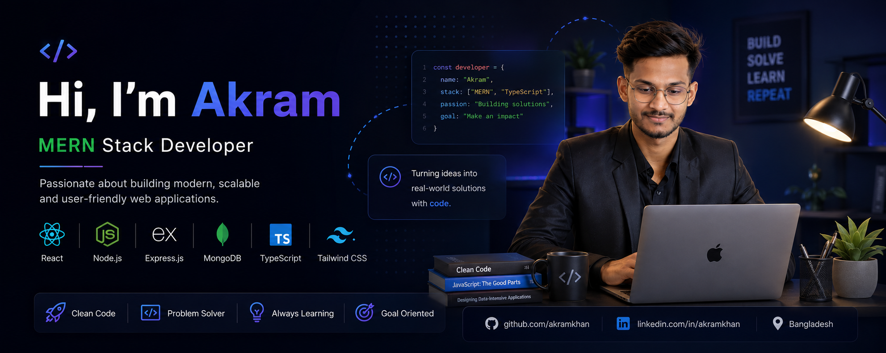

<div align="center">



# 👋 Hi, I'm Akram Mohammad Khan

### 💻 MERN Stack Developer

**I build full-stack web apps & responsive with Next.js, React, TypeScript, Node.js and MongoDB.**

<a href="https://akram-mohammad-khan-portfolio.vercel.app">
  
</a>
<a href="https://github.com/AkramMdkhan?tab=repositories">
  
</a>
<a href="https://www.linkedin.com/in/akrammdkhan">
  
</a>

</div>

---

## 👨‍💻 About Me

I'm a MERN stack developer who enjoys turning designs and ideas into responsive, clean and user-friendly web applications. I build full-stack projects with authentication, protected routes, REST APIs and database integration, and I deploy everything live.

```javascript
const akram = {
  name: "Akram Mohammad Khan",
  role: "MERN Stack Developer",
  focus: "Responsive, full-stack web apps",
  stack: ["Next.js", "React", "TypeScript", "Node.js", "MongoDB"],
  mindset: "Build • Solve • Learn • Repeat"
};
```

---

## 🛠️ Tech Stack

**Frontend**

<p>
  
</p>

**Backend & Database**

<p>
  
</p>

**Tools & Deployment**

<p>
  
</p>

---

## 🚀 Featured Projects

### 🧑‍💼 Portfolio Website

My personal portfolio with animated sections, project detail pages and a fully responsive layout.

**Tech:** Next.js • TypeScript • Tailwind CSS • Framer Motion

🔗 [Live Site](https://akram-mohammad-khan-portfolio.vercel.app) • [Repository](https://github.com/AkramMdkhan/akram-mohammad-khan-portfolio)

---

### 🤝 ShebaBondhu (Social Development Events Platform)

A community events platform with a separate client and server, authentication and a protected experience.

**Tech:** Next.js • TypeScript • Express • MongoDB • BetterAuth • JWT

🔗 [Live Site](https://shebabondhu-client.vercel.app) • [Client Repository](https://github.com/AkramMdkhan/shebabondhu-client)

---

### 🛒 BazarDor (বাজার দর)

A grocery price tracker with price movers, category pages, a protected product details page and email, Google and GitHub login.

**Tech:** Next.js • TypeScript • Tailwind CSS • DaisyUI • Better Auth • MongoDB

🔗 [Live Site](https://assignment-seven-bazardor.vercel.app) • [Repository](https://github.com/AkramMdkhan/assignment-seven-bazardor)

---

### 🏋️ Fit Log

A workout library app converted from a Figma design, with a workout plan, saved list, search and sorting.

**Tech:** Next.js • TypeScript • Tailwind CSS • DaisyUI • React Compiler

🔗 [Live Site](https://b-14-assignment-6-fit-log-xi.vercel.app) • [Repository](https://github.com/AkramMdkhan/B-14-Assignment-6-Fit-Log)

---

### 🧩 DevStack

A site to explore and compare dev technologies and build your own custom stack.

**Tech:** React • TypeScript • Vite • Tailwind CSS • React Toastify

🔗 [Live Site](https://brilliant-chaja-01e52a.netlify.app) • [Repository](https://github.com/AkramMdkhan/B-14-Assignment-5-Dev-Stack)

---

## 📊 GitHub Stats

<div align="center">


</div>

---

## 📫 Let's Connect

<div align="center">

<a href="https://www.linkedin.com/in/akrammdkhan">

</a>
<a href="https://mail.google.com/mail/?view=cm&to=akrammdkhan10@gmail.com">

</a>

### ⭐ Thanks for visiting my profile!


</div>
